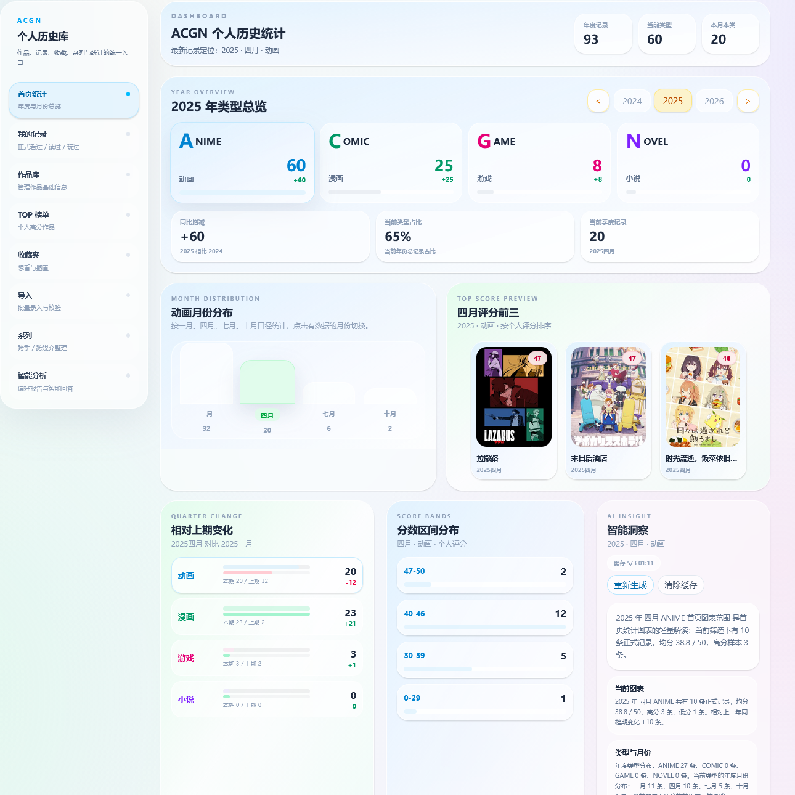
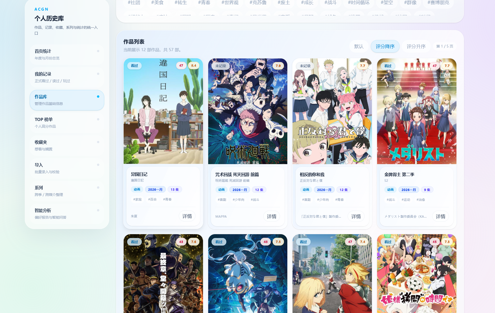
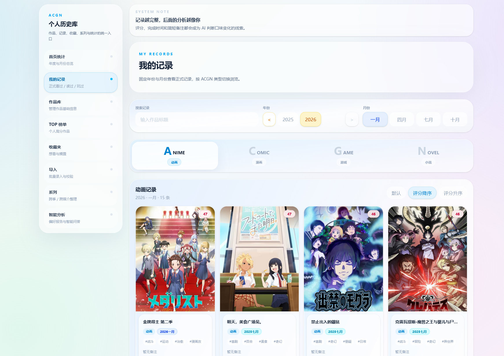
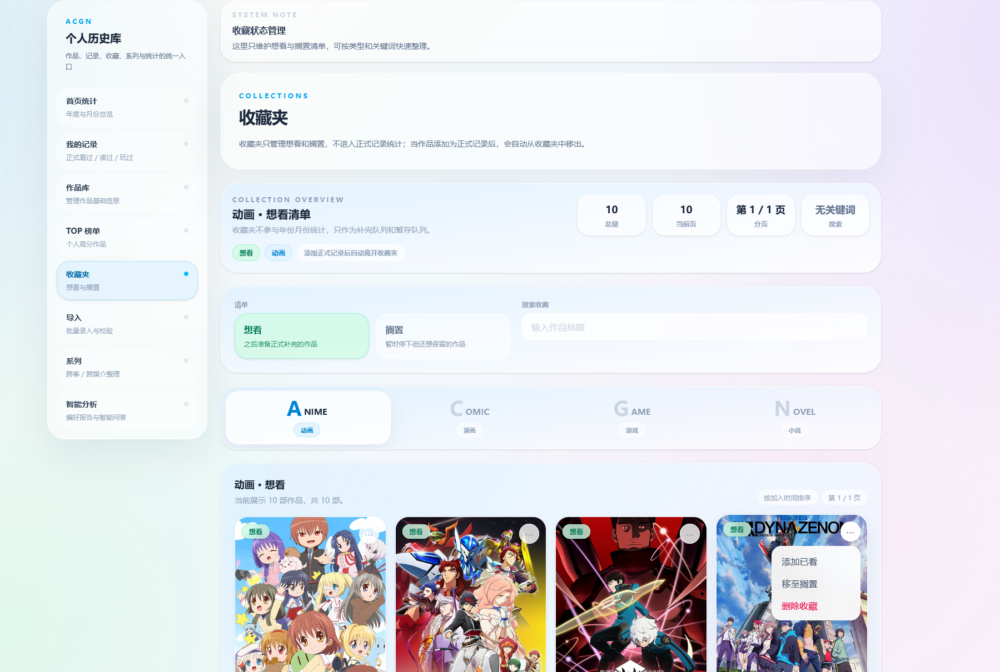
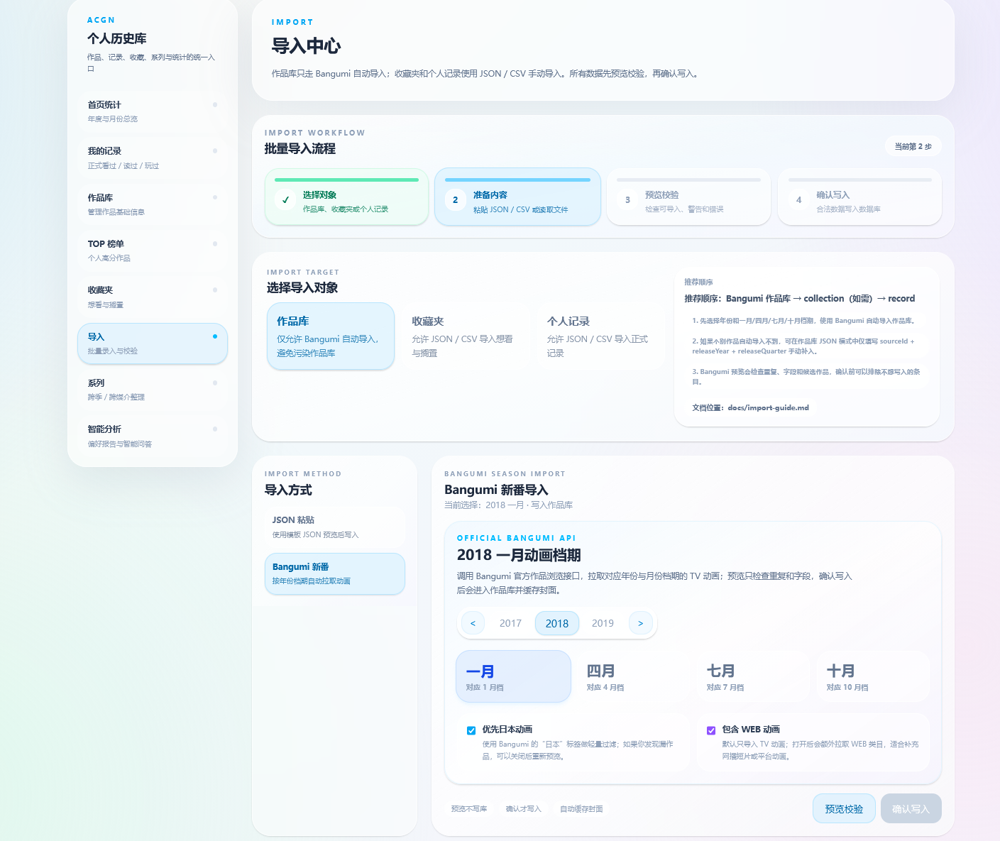
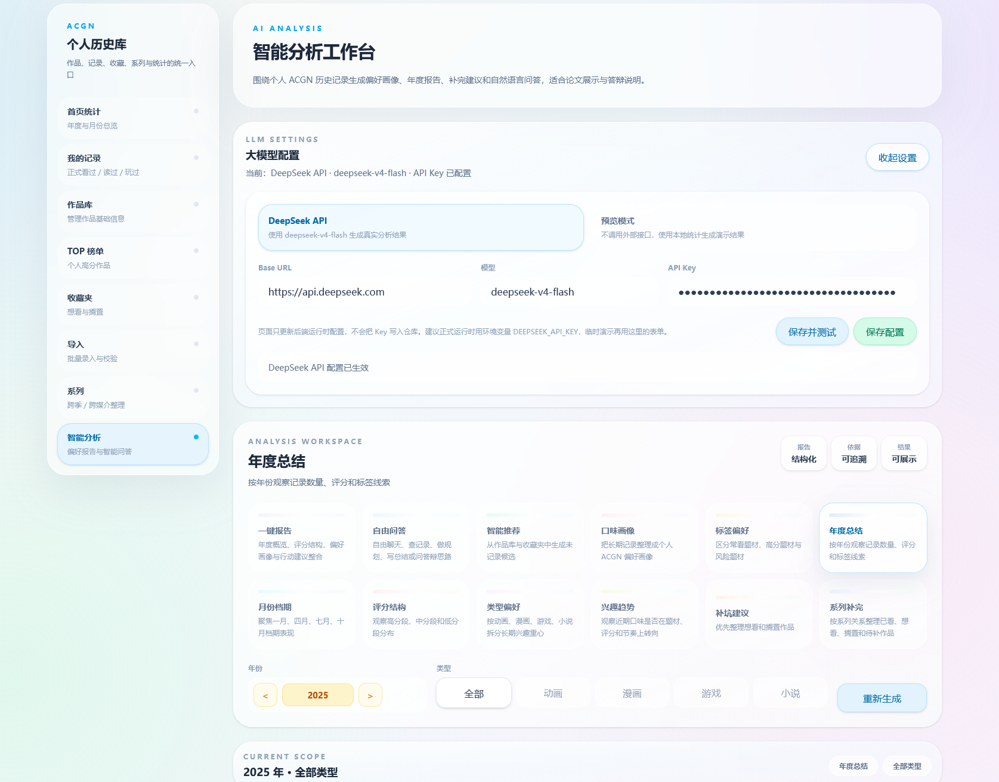
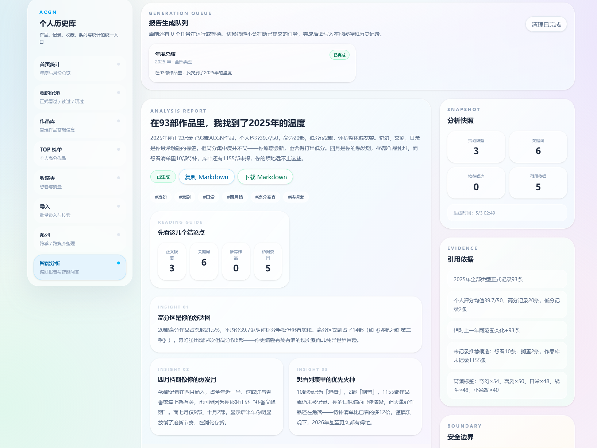
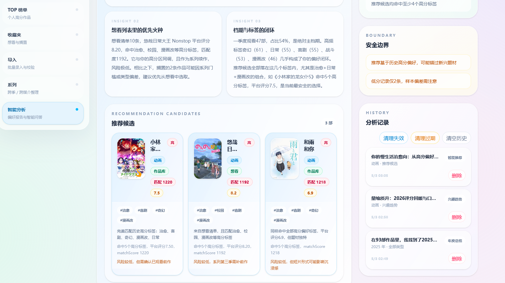
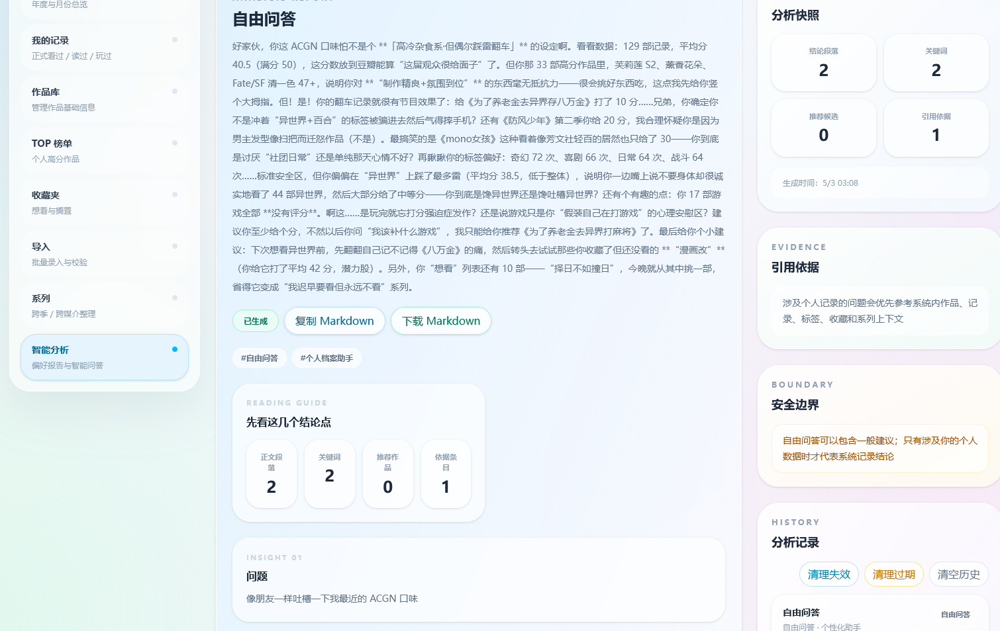
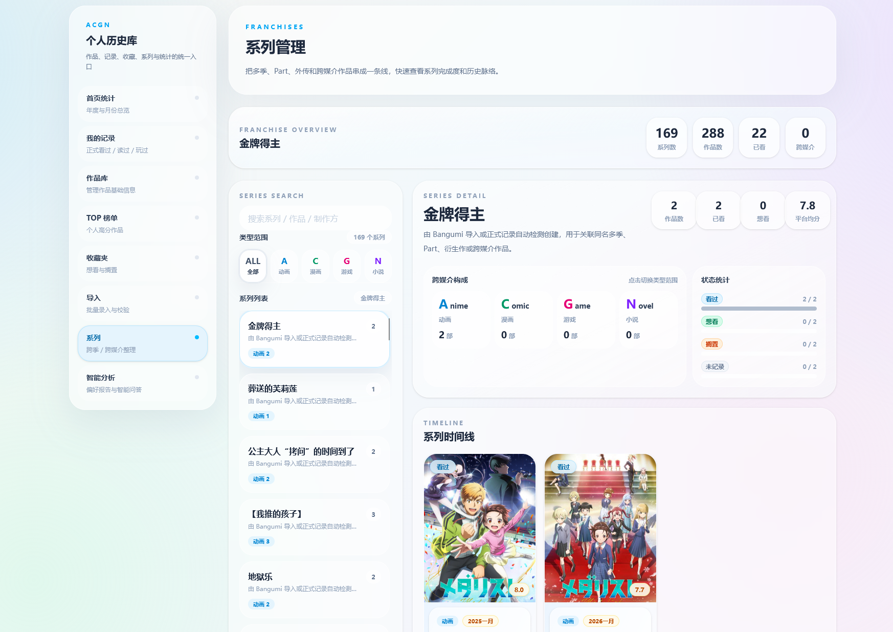

<div align="center">

# ACGN History Analyzer

**把看过、想看、搁置和补完计划整理成一套可以复盘的个人ACGN历史数据库。**

一个面向动画、漫画、游戏、小说的个人记录与智能分析系统。它不只是保存作品列表，而是把作品资料、正式记录、收藏状态、系列关系、标签特征和个人评分组织起来，再用大语言模型生成年度复盘、偏好解释、补完建议和自然语言问答结果。


</div>

---

## 目录

- [项目能做什么](#项目能做什么)
- [界面预览](#界面预览)
- [核心功能](#核心功能)
- [智能分析怎么工作](#智能分析怎么工作)
- [数据模型怎么理解](#数据模型怎么理解)
- [技术栈](#技术栈)
- [目录结构](#目录结构)
- [本地启动](#本地启动)
- [常用配置](#常用配置)
- [导入数据的推荐顺序](#导入数据的推荐顺序)
- [相关文档](#相关文档)

---

## 项目能做什么

ACGN History Analyzer 是一个给个人长期记录用的系统。

如果你的ACGN记录分散在Bangumi、表格、收藏夹、截图和个人笔记里，这个项目可以把它们整理到一套本地数据库中。作品资料、观看/阅读/游玩记录、想看清单、搁置清单、系列关系和标签会被分开管理，后续统计和智能分析都基于这些结构化数据生成。

系统的重点不是“又做一个收藏列表”，而是让个人数据继续产生价值：

- 今年看了什么，哪个季度最多；
- 哪些类型、标签、系列更符合自己的偏好；
- 哪些想看/搁置作品值得优先补完；
- 为什么推荐这部作品，而不是随便给一个片单；
- 可以直接用自然语言追问自己的历史记录。

---

## 界面预览

> 图片来自根目录下的 `picture/` 文件夹。README只挑选了最能说明系统流程的几张图，避免页面过长。

| 首页统计 | 作品库 |
|---|---|
|  |  |

| 我的记录 | 收藏夹 |
|---|---|
|  |  |

| 导入中心 | 智能分析 |
|---|---|
|  |  |

| 年度报告 | 智能推荐 |
|---|---|
|  |  |

| 自然语言问答 | 系列管理 |
|---|---|
|  |  |

---

## 核心功能

### 1. 作品库

作品库保存系统的主数据，包括标题、封面、简介、发行年份、发行档期、分类、平台评分、标签、系列和Bangumi来源信息。

作品库里的“有这部作品”，不等于“用户已经看过”。它只是系统认识这部作品的前提。

### 2. 我的记录

正式记录表示用户已经完成某部作品，并可以保存个人评分、完成年份、完成档期和备注。

当前规则是一部作品最多一条正式记录。重复导入同一作品时，系统会更新已有记录，而不是新增多条重复数据。

### 3. 收藏夹

收藏夹只保存未完成计划，主要是：

- `WANT`：想看、想读、想玩；
- `PAUSED`：搁置，之后可能继续补。

如果作品已经有正式记录，它就不再作为收藏保留。这样可以避免“已经看完”和“还想看”同时出现的混乱状态。

### 4. 系列管理

很多ACGN作品不是单一条目，而是多季、剧场版、外传、Part、漫画、小说或游戏改编共同组成一个系列。

系列模块用于把这些作品组织到一起，后续智能分析和补完推荐会利用这部分信息判断哪些作品属于同一条补完链路。

### 5. 导入中心

导入中心用于处理历史数据迁移。系统支持：

- Bangumi季度作品导入；
- Bangumi `sourceId` 补录；
- 收藏JSON/CSV导入；
- 正式记录JSON/CSV导入；
- Bangumi往返JSON导出。

导入不是直接写库，而是先预览、再确认。预览阶段会检查字段格式、重复数据和作品匹配歧义，用户确认后才正式导入。

### 6. 首页与榜单

首页用于快速看整体数据，包含年度/季度统计、分类占比、高分记录和智能洞察。TOP榜单则集中展示高分作品和年度代表作品。

### 7. 智能分析

智能分析是项目的重点模块。它基于本地结构化数据生成：

- 年度总结；
- 季度分析；
- 兴趣趋势；
- 评分结构；
- 标签偏好；
- 智能推荐；
- 系列补完建议；
- 综合报告；
- 自然语言问答。

---

## 智能分析怎么工作

这个项目里的大语言模型不是凭空聊天，也不是直接编一个结论。

后端会先把本地数据整理成分析上下文，包括：

- 已完成作品；
- 想看和搁置作品；
- 作品标签；
- 系列关系；
- 评分分布；
- 年度和季度趋势；
- 推荐候选；
- evidence引用依据。

然后系统再根据不同任务组织Prompt，让模型负责把结构化数据转成可读的分析结果。

简单说：

```text
数据库负责保存事实
后端负责整理事实
大语言模型负责解释事实
前端负责展示结果
```

这样做的好处是，报告和推荐理由可以回到本地作品、评分、标签、收藏状态中核对，减少模型脱离数据乱写的情况。

---

## 数据模型怎么理解

项目里几个核心概念不要混在一起：

| 概念 | 表示什么 | 举例 |
|---|---|---|
| `subject` | 作品资料 | 系统知道《葬送的芙莉莲》这部作品 |
| `user_subject_record` | 正式完成记录 | 用户在2024年一月档补完，并打了47分 |
| `user_subject_collection` | 未完成计划 | 用户想看或暂时搁置某部作品 |
| `franchise` | 系列 | 把多季、剧场版、外传归到同一系列 |
| `tag` | 标签 | 奇幻、校园、治愈、悬疑、战斗等 |
| `background_job` | 后台任务 | 导入、LLM分析等耗时操作的进度 |
| `llm_analysis_result_cache` | 智能分析缓存 | 避免相同报告反复调用模型生成 |

作品定位时，系统优先使用更稳定的ID：

```text
subjectId > sourceId > subjectTitle + seasonIndex + partIndex
```

其中 `sourceId` 当前主要对应Bangumi的subject id。

---

## 技术栈

| 层级 | 技术 |
|---|---|
| 前端 | React 19、TypeScript、Vite、Tailwind CSS v4、React Query、Axios、React Router |
| 后端 | Java 17、Spring Boot 3.5、Spring Web、Spring Data JPA、Validation、Caffeine Cache |
| 数据库 | MySQL，Hibernate自动维护表结构 |
| 外部数据 | Bangumi API |
| 智能分析 | DeepSeek真实调用 / Mock模式兜底 |
| 本地资源 | Bangumi封面缓存到 `uploads/covers` |

---

## 目录结构

```text
ACGN-History-Analyzer/
├─ backend/                  后端 Spring Boot 工程
│  ├─ src/main/java/com/mykr/acgnhistoryanalyzer/
│  │  ├─ controller/          REST API 入口
│  │  ├─ service/             核心业务逻辑
│  │  ├─ repository/          JPA 查询
│  │  ├─ entity/              JPA 实体
│  │  ├─ request/             请求 DTO
│  │  ├─ response/            响应 DTO
│  │  ├─ job/                 后台任务
│  │  ├─ llm/                 LLM 上下文、Prompt、客户端、缓存
│  │  └─ config/              缓存、静态资源、请求追踪等配置
│  └─ src/main/resources/
│     ├─ application.properties
│     └─ db/indexes.sql       可选手动索引脚本
│
├─ frontend/                  前端 React 工程
│  └─ src/
│     ├─ routes/              路由
│     ├─ pages/               页面编排
│     ├─ components/          复用组件
│     ├─ api/                 请求封装和前端 DTO
│     ├─ jobs/                后台任务轮询和 Toast
│     ├─ hooks/               页面状态持久化 Hook
│     ├─ query/               React Query key/cache
│     ├─ theme/               分类、档期、评分等视觉 token
│     └─ utils/               工具函数
│
├─ docs/                      架构、数据库、导入、LLM 文档
├─ picture/                   README 和展示用系统截图
├─ sql/                       手动维护脚本
├─ uploads/                   本地封面缓存
└─ README.md
```

---

## 本地启动

### 1. 准备环境

建议准备：

- Java 17；
- MySQL 8.x；
- Node.js 20或以上；
- IntelliJ IDEA；
- Navicat 17，方便查看和迁移数据库。

### 2. 创建数据库

项目会根据JPA实体自动维护表结构，但需要先有一个空数据库。

```sql
CREATE DATABASE acgn_history_analyzer
DEFAULT CHARACTER SET utf8mb4
DEFAULT COLLATE utf8mb4_unicode_ci;
```

默认数据库连接在：

```text
backend/src/main/resources/application.properties
```

默认值为：

```properties
spring.datasource.url=${DB_URL:jdbc:mysql://localhost:3306/acgn_history_analyzer}
spring.datasource.username=${DB_USERNAME:root}
spring.datasource.password=${DB_PASSWORD:abc123}
spring.jpa.hibernate.ddl-auto=update
```

如果你的MySQL密码不是 `abc123`，需要修改配置，或者通过环境变量传入。

### 3. 启动后端

Windows：

```powershell
cd backend
.\mvnw.cmd spring-boot:run
```

macOS / Linux：

```bash
cd backend
./mvnw spring-boot:run
```

后端默认连接本地MySQL，接口前缀为：

```text
http://localhost:8080/api
```

### 4. 启动前端

```powershell
cd frontend
npm install
npm run dev
```

启动后打开终端显示的Vite地址，一般是：

```text
http://localhost:5173
```

### 5. 验证构建和测试

前端：

```powershell
cd frontend
npm run lint
npm run build
```

后端：

```powershell
cd backend
.\mvnw.cmd test
```

---

## 常用配置

### 数据库配置

可以直接修改 `application.properties`，也可以使用环境变量覆盖：

```properties
DB_URL=jdbc:mysql://localhost:3306/acgn_history_analyzer
DB_USERNAME=root
DB_PASSWORD=你的MySQL密码
```

### LLM配置

默认支持DeepSeek，也可以进入前端智能分析页切换为预览模式。预览模式会走Mock，不需要真实API key。

```properties
app.llm.enabled=true
app.llm.provider=deepseek
app.llm.base-url=https://api.deepseek.com
app.llm.api-key=${DEEPSEEK_API_KEY:}
app.llm.model=deepseek-v4-flash
app.llm.timeout-seconds=30
app.llm.temperature=0.4
app.llm.max-tokens=3000
app.llm.cache-content-version=1
app.llm.result-cache-days=14
```

如果要真实调用模型，设置环境变量：

```powershell
setx DEEPSEEK_API_KEY "你的API Key"
```

重新打开终端后再启动后端。

---

## 导入数据的推荐顺序

第一次使用时，建议按这个顺序来：

```text
导入作品库
↓
补录缺失的 Bangumi sourceId
↓
导入收藏 WANT / PAUSED
↓
导入正式记录
↓
检查首页、作品库、记录页和智能分析结果
```

原因很简单：收藏和正式记录都要先找到对应作品。如果作品库太少，后续导入就容易出现匹配失败或标题歧义。

导入中心的基本流程是：

```text
preview 预览校验
↓
处理错误行或歧义候选
↓
import 正式导入
↓
后台任务执行
↓
全局 Toast 提示结果
```

常见结果码：

| 结果码 | 含义 |
|---|---|
| `CAN_IMPORT` | 预览通过，可以写入 |
| `IMPORTED` | 正式导入成功 |
| `UPDATED` | 命中已有数据并更新 |
| `AMBIGUOUS` | 匹配到多个候选，需要选择 |
| `SKIPPED` | 按规则跳过 |
| `ERROR` | 字段或业务校验失败 |


---

## 相关文档

| 文档 | 内容 |
|---|---|
| [`docs/architecture-overview.md`](docs/architecture-overview.md) | 架构、页面、接口、任务和前端体验约定 |
| [`docs/database-schema.md`](docs/database-schema.md) | 数据库表、字段、约束和索引 |
| [`docs/import-guide.md`](docs/import-guide.md) | 导入流程、请求格式、结果码和排障 |
| [`docs/llm-guide.md`](docs/llm-guide.md) | LLM链路、配置、缓存和前端消费 |

---

## 项目定位

这个项目更适合个人长期使用，也适合作为一个完整的Java前后端工程练习样例。它覆盖了数据建模、接口设计、后台任务、缓存、文件资源、前端状态持久化、导入校验和大语言模型集成等内容。

它的核心目标很明确：

> 把分散的ACGN个人记录整理成稳定的数据，再让这些数据变成可以理解、可以追问、可以指导补完计划的分析结果。
