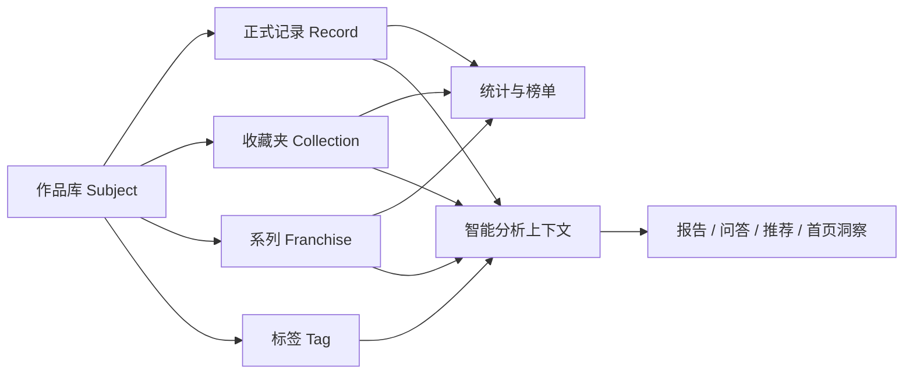

# ACGN History Analyzer

面向 ACGN 的大语言模型个人历史数据智能分析系统。

它不是一个传统后台，也不是单纯的“我看过什么”清单。这个项目想做的是一间自己的 ACGN 记忆档案室：作品有封面、标签和系列关系；记录有年份、月份档期、评分和备注；想看和搁置不再混进正式记录；最后再把这些数据交给智能分析模块，生成偏好画像、年度报告、补完建议和自然语言问答。

ACGN 在这里指：

```text
A = Anime   动画
C = Comic   漫画
G = Game    游戏
N = Novel   小说
```

一句话概括：

```text
把分散在记忆、表格和平台里的 ACGN 经历，整理成可检索、可统计、可分析、可展示的个人历史数据系统。
```

这个 README 既是项目说明，也是论文初稿和答辩展示时可以反复回看的路线图。

## 项目状态

当前版本已经形成一套可运行、可展示、可写进论文初稿的 Web 系统。

核心链路已经跑通：

```text
作品库 -> 个人记录 -> 收藏夹 -> 系列 -> 标签 -> 统计 -> 导入 -> 智能分析
```

第三阶段的智能分析模块也已经接入到系统展示层：系统能够基于作品、记录、标签、收藏和系列数据生成结构化分析结果，并通过首页洞察、智能分析工作台和自然语言问答入口展示出来。

## 核心设计思想

这个项目最重要的取舍，是把“作品本体”和“个人行为”拆开。

很多记录系统会把想看、看过、搁置、评分、作品信息都混在一起。短期看起来方便，长期会导致统计和分析混乱。这里采用更清楚的结构：

```text
作品库：这是什么作品
正式记录：我什么时候完成、打了多少分、留下什么评价
收藏夹：我想看什么、暂时搁置什么
系列：哪些作品属于同一个大系列
标签：作品具有什么题材和风格特征
智能分析：基于以上结构化数据生成解释和建议
```

这样设计之后，系统可以回答的问题就不只是“我看过什么”，而是：

- 我在哪些年份和月份档期最活跃？
- 我更偏好哪类作品？
- 哪些标签经常高分，哪些标签看得多但评分不稳定？
- 哪些系列还有坑没补？
- 想看列表里哪些作品最值得优先处理？

## 系统数据流



这条链路也是论文里最容易讲清楚的主线：先做数据治理，再做可视化展示，最后让智能分析模块基于结构化数据进行总结。

## 主要功能

### 首页统计

首页不是欢迎页，而是系统的数据门面。

它展示：

- 年份类型总览
- 一月、四月、七月、十月档期分布
- 当前筛选下评分前三
- 当前月份的类型构成
- 相对往年变化
- 首页智能洞察

系统统一使用新番常见说法中的 `1 / 4 / 7 / 10 月` 档期，不再使用春夏秋冬。

月份档期在数据库中仍使用 `releaseQuarter` / `recordQuarter` 这类字段名，但业务含义已经统一为：

```text
1 = 一月档
2 = 四月档
3 = 七月档
4 = 十月档
```

也就是说，字段名沿用 quarter，是为了代码和数据库结构稳定；页面表达统一使用“一月、四月、七月、十月”。

### 作品库

作品库只表示作品本体，不表示“我看过”。

例如《进击的巨人 Final Season Part 1》是一个作品；我什么时候看、打几分、写了什么备注，是正式记录的事情。

作品库支持：

- Anime / Comic / Game / Novel 类型切换
- 搜索、年份、月份、状态筛选
- 标签筛选
- 默认标题排序、平台评分升降序
- 作品卡片和详情抽屉
- 添加 / 编辑正式记录
- 加入想看、加入搁置、回到未记录
- 删除作品
- 平台评分和个人评分同时展示

作品库的默认排序偏向标题，方便同系列作品聚在一起。评分排序使用平台评分，因为作品库描述的是作品本体，而不是个人完成行为。

### 我的记录

我的记录只展示正式完成记录。

不会出现想看，也不会出现搁置。

记录字段关注的是个人行为：

- 记录年份
- 记录月份档期
- 个人评分，0 到 50 分
- 评价 / 备注

页面支持固定年份、固定月份、类型切换、搜索、标题排序、个人评分升降序、查看详情、编辑记录和删除记录。

记录页的评分排序使用个人评分，因为这里讨论的是“我的历史记录”，不是平台评价。

### 收藏夹

收藏夹只管理两种状态：

```text
WANT   想看
PAUSED 搁置
```

它和正式记录是分开的。一个作品一旦添加正式记录，就会从想看或搁置中移出。

收藏夹支持：

- 想看 / 搁置切换
- 类型筛选
- 搜索
- 分页
- 移至另一清单
- 添加已看
- 删除收藏

### 系列管理

系列页是这个项目比较有特色的地方。

ACGN 作品天然有多季、Part、外传、重制版、跨媒介改编。系列模块用来把它们串起来。

一个系列下面可以同时存在：

- 动画
- 漫画
- 游戏
- 小说
- 多季
- 多 Part
- 外传

系列页支持：

- 系列搜索
- 类型范围筛选
- 系列概览统计
- 跨媒介构成
- 状态统计
- 横向时间线
- 查看作品详情
- 移出系列
- 删除系列

智能分析工作台还会基于系列关系生成“系列补完分析”：只围绕已经有正式记录牵引出的系列，整理已看、想看、搁置和待补作品，避免把作品库里所有未记录作品都推到用户面前。

### TOP 榜单

TOP 页按 ACGN 类型切换，不提供“全部”混排。

榜单按个人评分排序，但不显式排名。因为同分作品可能很多，强行标出第几名会制造一种假的精确感。

页面展示：

- 高分作品卡片
- 评分段统计
- 四类作品切换
- 作品详情入口

评分段为：

```text
47-50
40-46
30-39
0-29
```

### 导入中心

导入中心用于批量录入历史数据。

导入流程是：

```text
选择对象 -> 准备内容 -> 预览校验 -> 确认写入
```

支持：

- 作品库导入
- 收藏夹导入
- 正式记录导入
- JSON 粘贴
- CSV 粘贴 / 文件读取
- 模板字段说明
- 预览校验
- 确认写入
- 错误行不阻塞合法行

推荐导入顺序：

```text
subjects -> collections -> records
```

完整导入字段说明见：

```text
docs/import-guide.md
```

### 手动整理历史数据的建议

如果是从旧表格、Bangumi 页面、个人备忘录里整理数据，建议按下面顺序做：

1. 先整理作品库 `subjects`。
2. 再整理想看和搁置 `collections`。
3. 最后整理正式记录 `records`。

原因很简单：记录和收藏都要指向作品。先把作品库建好，后面的导入失败率会低很多。

标签建议保持“够用但不泛滥”：

```text
每部作品 3 到 7 个标签比较舒服。
```

例如：

```text
#校园 #恋爱喜剧 #游戏 #青春 #误会系
```

这些标签会同时影响作品库筛选和智能分析结果。

### 智能分析

智能分析工作台是第三阶段的核心页面。

它把作品库、记录、标签、收藏夹和系列数据整理成分析上下文，再生成结构化报告。

当前支持：

- 一键报告
- 自然语言问答
- 智能推荐
- 口味画像
- 标签偏好
- 年度总结
- 月份档期总结
- 类型偏好
- 评分结构
- 补坑建议
- 偏好矛盾分析
- 系列补完分析

智能分析结果包含：

- 报告标题
- 摘要
- 关键词
- 结构化分析段落
- 推荐候选
- 引用依据
- 安全边界
- 分析记录
- Markdown 复制，方便整理到论文或阶段报告中

自然语言问答示例：

```text
2025 年我有哪些高分动画？
我是不是更喜欢日常标签？
想看里有什么适合优先补？
哪些标签看得多但评分不稳定？
```

智能分析模块只读数据，不会自动修改评分、标签、记录或收藏状态。

## 页面和接口关系

前端页面并不是直接散乱地调用后端，而是通过 `api/` 下的封装文件统一请求。

```text
首页统计       -> /api/home/*、/api/llm/analysis/home-insight
作品库         -> /api/subjects/*、/api/tags
我的记录       -> /api/records/*
TOP 榜单       -> /api/top/*、/api/records/stats/*
收藏夹         -> /api/collections/*
系列管理       -> /api/franchises/*
导入中心       -> /api/import/*、/api/subjects/import、/api/records/import、/api/collections/import
智能分析       -> /api/llm/*
选项数据       -> /api/options/*
```

这样拆的好处是：页面只关心“我要展示什么”，接口层负责“怎么向后端要数据”。后续如果接口参数、返回结构或智能分析服务发生变化，优先改 `api/` 和 `mappers/`，不需要把每个页面都翻一遍。

## 数据模型

### Subject：作品本体

作品库中的基本单位。

作品唯一性规则：

```text
titleCn + subtitle + seasonIndex + partIndex + category
```

这些字段全部相同，才视为同一个作品。任意一个不同，就可以是另一个作品。

### UserSubjectRecord：正式记录

正式看过、读过或玩过的记录。

它不保存想看，也不保存搁置。

### UserSubjectCollection：收藏夹

独立于正式记录，只保存：

```text
WANT
PAUSED
```

### Franchise：系列

用于串联多季、Part、外传、重制版和跨媒介作品。

例如一个系列可以同时挂动画、漫画、游戏和小说。

### Tag：作品标签

作品标签用于细分类，也用于智能分析。

例如：

```text
#奇幻 #战斗 #校园 #恋爱喜剧 #漫画改
```

标签不是装饰。它们是后续兴趣画像、推荐理由和偏好分析的重要特征。

## 智能分析如何工作

系统不会只把作品标题丢给模型。

它会先从数据库里整理结构化上下文：

- 用户正式记录数量
- 年份和月份档期分布
- 类型分布
- 个人评分分布
- 高分作品和低分作品
- 标签出现次数和标签均分
- 想看 / 搁置候选
- 作品库未记录候选
- 系列关系

然后再根据分析任务生成结果。

这样做的好处是：分析不是凭空猜测，而是能回到系统里的记录、评分、标签和收藏数据中找到依据。

## 后端接口概览

接口统一返回 `ApiResponse`，前端请求层会负责解包成功数据和处理错误提示。

```text
基础接口
GET    /api/hello
GET    /api/health

作品库
GET    /api/subjects
GET    /api/subjects/page
GET    /api/subjects/{id}
POST   /api/subjects
PUT    /api/subjects/{id}
DELETE /api/subjects/{id}
POST   /api/subjects/import/preview
POST   /api/subjects/import

正式记录
GET    /api/records
GET    /api/records/page
GET    /api/records/{id}
POST   /api/records
PUT    /api/records/{id}
DELETE /api/records/{id}
POST   /api/records/import/preview
POST   /api/records/import
GET    /api/records/stats/score-bands
GET    /api/records/stats/quarter-overview
GET    /api/records/stats/year-overview
GET    /api/records/high-score

收藏夹
GET    /api/collections
GET    /api/collections/{id}
POST   /api/collections
POST   /api/collections/want/{subjectId}
POST   /api/collections/paused/{subjectId}
PUT    /api/collections/{id}
DELETE /api/collections/{id}
POST   /api/collections/import/preview
POST   /api/collections/import

系列
GET    /api/franchises
GET    /api/franchises/{id}
POST   /api/franchises
PUT    /api/franchises/{id}
DELETE /api/franchises/{id}
DELETE /api/franchises/{franchiseId}/subjects/{subjectId}

标签
GET    /api/tags

首页、TOP、导入和智能分析
GET    /api/home/quarter-dashboard
GET    /api/home/search
GET    /api/top/year-high-score
GET    /api/top/masterpieces
GET    /api/import/overview
GET    /api/import/templates/subject
GET    /api/import/templates/record
GET    /api/import/templates/collection
GET    /api/llm/status
GET    /api/llm/analysis/*
GET    /api/llm/qa
```

接口命名尽量保持“资源名 + 行为”的形式，方便论文中说明 RESTful 风格。

## 技术栈

后端：

```text
Java 17
Spring Boot 3
Spring MVC
Spring Data JPA
MySQL
RESTful API
统一 ApiResponse 返回结构
```

前端：

```text
React
TypeScript
Vite
Tailwind CSS
React Router
Axios
```

推荐开发工具：

```text
IntelliJ IDEA
Navicat 17
Node.js
Maven
```

## 项目结构

```text
ACGN-History-Analyzer
├─ backend
│  ├─ src/main/java/com/mykr/acgnhistoryanalyzer
│  │  ├─ common          通用响应结构
│  │  ├─ controller      REST 接口入口
│  │  ├─ entity          JPA 实体
│  │  ├─ enums           枚举
│  │  ├─ llm             智能分析上下文与生成入口
│  │  ├─ repository      数据访问
│  │  ├─ request         请求 DTO
│  │  ├─ response        响应 DTO
│  │  ├─ service         业务逻辑
│  │  └─ specification   动态查询条件
│  └─ src/main/resources
│     └─ application.properties
├─ frontend
│  └─ src
│     ├─ api             前端接口封装
│     ├─ components      通用组件和业务组件
│     ├─ mappers         后端数据到前端视图模型的转换
│     ├─ pages           页面
│     ├─ routes          路由
│     ├─ theme           主题色和视觉规则
│     └─ types           TypeScript 类型
├─ docs
│  ├─ import-guide.md
│  └─ thesis-demo-route.md
├─ sql
└─ uploads               本地封面缓存目录
```

## 运行前准备

### 1. 创建数据库

MySQL 中创建数据库：

```sql
CREATE DATABASE acgn_history_analyzer
  DEFAULT CHARACTER SET utf8mb4
  DEFAULT COLLATE utf8mb4_unicode_ci;
```

后端配置文件：

```text
backend/src/main/resources/application.properties
```

默认配置：

```properties
spring.datasource.url=jdbc:mysql://localhost:3306/acgn_history_analyzer
spring.datasource.username=root
spring.datasource.password=abc123
spring.jpa.hibernate.ddl-auto=update
```

如果你的 MySQL 用户名或密码不同，改这里即可。

### 2. 启动后端

推荐用 IntelliJ IDEA：

1. 打开 `backend`。
2. 等 Maven 依赖加载完成。
3. 运行 Spring Boot 启动类。
4. 后端默认地址：

```text
http://localhost:8080
```

也可以用本机 Maven：

```powershell
cd backend
mvn spring-boot:run
```

### 3. 启动前端

```powershell
cd frontend
npm install
npm.cmd run dev
```

前端默认地址通常是：

```text
http://localhost:5173
```

前端通过 Vite 代理访问后端 `/api`。如果页面报：

```text
Request failed with status code 502
```

先检查后端是否已经启动。

## 常用命令

后端编译：

```powershell
cd backend
mvn.cmd -q -DskipTests compile
```

前端构建：

```powershell
cd frontend
npm.cmd run build
```

前端 lint：

```powershell
cd frontend
npm.cmd run lint
```

PowerShell 如果拦截 `npm.ps1`，使用 `npm.cmd`。

## 封面图片

作品导入时，`coverUrl` 可以写远程图片地址，例如 Bangumi 封面。

正式导入时，后端会尝试把封面下载到：

```text
uploads/covers/
```

数据库中保存的地址会变成：

```text
/api/assets/covers/xxx.jpg
```

如果手动放图，也放到：

```text
uploads/covers/
```

然后 JSON 中写：

```json
"coverUrl": "/api/assets/covers/your-file-name.jpg"
```

`uploads/` 是本地缓存目录，不建议提交到 git。

## 页面路线

路由：

```text
/               首页统计
/records        我的记录
/library        作品库
/top            TOP 榜单
/collections    收藏夹
/import         导入中心
/franchises     系列管理
/analysis       智能分析
```

论文截图路线见：

```text
docs/thesis-demo-route.md
```

推荐演示顺序：

1. 首页统计：展示总体数据门面。
2. 作品库：展示作品本体、标签、筛选和详情。
3. 我的记录：展示正式记录和个人评分。
4. TOP 榜单：展示高分作品和评分段。
5. 收藏夹：展示想看 / 搁置和添加已看。
6. 系列管理：展示跨媒介系列和时间线。
7. 导入中心：展示预览校验和确认写入。
8. 智能分析：展示报告、问答、推荐和引用依据。

## 论文里可以怎么讲

这个项目可以按三层来介绍。

第一层是数据管理：

- 作品库保存作品本体。
- 正式记录保存个人完成行为。
- 收藏夹保存想看和搁置。
- 系列保存跨季、Part、外传和跨媒介关系。
- 标签保存作品题材特征。

第二层是数据展示：

- 首页统计
- 记录列表
- 作品卡片
- TOP 榜单
- 系列时间线
- 导入校验结果

第三层是智能分析：

- 年度总结
- 口味画像
- 标签偏好
- 评分结构
- 智能推荐
- 自然语言问答

核心设计点是：系统先把个人历史数据结构化，再让智能分析模块基于这些结构化数据生成解释。这样比直接把一堆文本交给模型更稳定，也更容易在论文中说明系统设计。

也可以按“问题、设计、实现、展示”这条线讲：

```text
问题：个人 ACGN 历史数据分散、难检索、难统计、难总结。
设计：拆分作品、记录、收藏、系列和标签，形成结构化历史档案。
实现：Spring Boot 提供 RESTful API，React 前端负责页面交互和可视化展示。
展示：通过首页、作品库、记录、收藏、系列、导入和智能分析完成闭环。
```

答辩时可以重点强调两点：

- 这不是普通后台管理系统，而是围绕个人 ACGN 历史数据设计的垂直领域系统。
- 智能分析不是孤立页面，而是建立在作品、记录、标签、系列等结构化数据之上。

## 常见问题

### 前端 502

通常是后端没启动。

前端页面请求 `/api`，Vite 会代理到后端。如果 `8080` 端口没有服务，作品库、记录、收藏夹等页面都会加载失败。

### 导入时有些行失败

这是正常设计。

导入接口按行处理。字段错误会返回 `ERROR`，重复或无法匹配会返回 `SKIPPED`，其他合法行仍然可以继续导入。

### 系列没有自动出现

系列自动检测主要围绕正式记录触发。

如果只是导入一大批未记录作品，系统不会急着把所有库存作品都塞进系列页。这样可以避免系列页被无关数据撑乱。

### 为什么评分是 0 到 50

个人评分使用 0 到 50，是为了比常见 10 分制保留更多主观细节。

平台评分仍按平台原始格式展示，一般是 0 到 10。

## 开发拆分思路

前端没有把所有逻辑堆在一个文件里。

大致拆法：

- `api/`：只负责请求后端。
- `types/`：定义 TypeScript 类型。
- `mappers/`：把后端返回值转换成前端卡片需要的视图模型。
- `components/`：可复用的卡片、弹窗、反馈状态、详情抽屉。
- `pages/`：页面级逻辑，负责把接口、状态和组件串起来。

这样拆不是为了显得复杂，而是为了后续继续扩展智能分析、缓存、导出、报告历史时不至于把页面写成一团。

## 后续可扩展方向

- 分析报告持久化
- 智能分析历史详情页
- 报告导出为 Markdown / PDF
- 更细的推荐算法权重
- 系列自动补全
- Bangumi 自动导入新番
- 首页和列表缓存
- 更丰富的图表组件

## 维护约定

为了后续继续扩展，建议保持下面几条约定：

- 不把想看、搁置写进正式记录表。
- 不在作品库里保存个人完成行为。
- 新增页面时优先复用已有卡片、弹窗、空状态和错误状态组件。
- 新增接口时保持 `ApiResponse` 返回结构一致。
- 涉及作品展示时，尽量同时考虑封面、标签、评分、状态和系列关系。
- 涉及智能分析时，优先从结构化数据生成上下文，再生成自然语言结果。

## 最后

这个系统的重点不是替用户“评价作品”，而是帮用户把自己的 ACGN 历史整理得足够清楚。

当作品、记录、标签、系列和评分都放在正确的位置上，智能分析才有意义。它最后呈现出来的，不只是一堆表格，而是一条自己追番、补漫画、玩游戏、读小说留下来的时间线。
